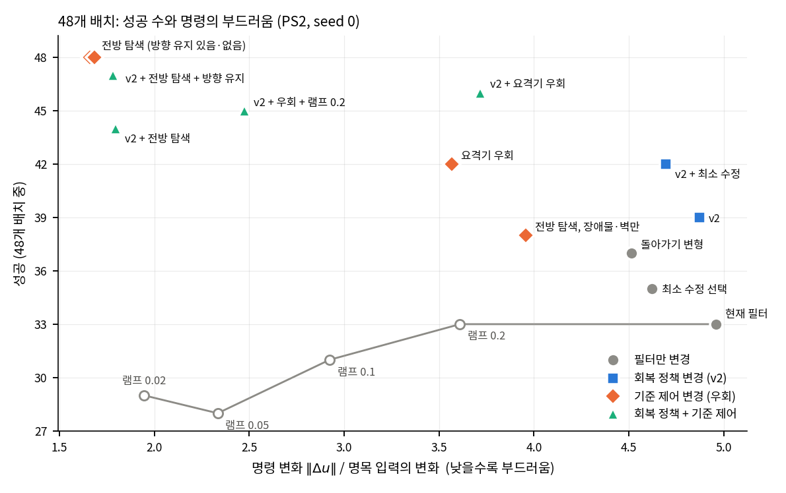

# Time-ups, herding and the nominal — CPU study on 48 test scenes (2026-10-31)

Seed-0 models of the report run (`../final/run`), test scenes of seed 9001, 15 s, CPU replay
(`scripts/eval_strike_filter.py --only_episodes ... --save_traj 1`).

The 48 scenes:
- 32 hard scenes from the report's GPU evaluation (PS2, final filter, seed 0): the 16 scenes it did not strike (15 time-ups,
  the contact in 845) and its 16 slowest strikes;
- 16 random scenes.

Each folder holds one setting's evaluation table and per-episode records. `compare.md` is the paired comparison against the
report's filter, `scenes.md` the per-scene outcomes where settings differ, `herding.md` the herding statistics.

Statistics:
- won / lost: scenes the setting strikes and the reference does not, and the reverse; p from the exact McNemar test;
- strike time: over the scenes both strike, mean difference and Wilcoxon signed-rank p;
- herded: seconds per episode with $0 < h_c < 0.35$ m while flying within 0.5 m/s of the chaser speed $v_c$.

Small sample: these numbers rank the options; the GPU run on 1000 scenes × 2 seeds (`docker_batch/run_strike_improve.sh`)
gives the final figures. The CPU replay of the reference strikes 17 of the 32 hard scenes; the GPU run struck 16, a
numerical difference near the 15 s limit.

## Why the filter times out: herding

All 14 time-ups of the report's filter are herding:
- a chaser between the drone and the target pushes the drone back at about $v_c$ while $h_c$ stays on the 0.2 m
  margin of new plans;
- herded seconds: 6.2 per time-up and 2.6 per strike;
- while herded in time-ups the drone moves 10.4 m away from the target, at 154° (median) from the target direction;
- the certificates are fresh (98 %) and the blend is mostly 0.25–0.5, so this is not a lost certificate or chattering.

The pursuer margin explains it:

$$h_c = R - (r_c + r_d) - s\,\delta - \frac{s^2}{2a_e}, \qquad s = \max(v_c - e^\top v,\ 0).$$

- Backing away at $e^\top v = v_c$ gives $s = 0$, so $h_c = R - (r_c + r_d)$ stays constant.
- Turning sideways ($e^\top v = 0$) gives $s = v_c$, which costs $v_c\delta + v_c^2/(2a_e) = 0.4 + 0.4 = 0.8$ m. A sideways
  turn therefore needs a range of at least 1.0 m above contact.
- The filter takes the certified command closest to the nominal (largest λ). With the nominal pointing at the target
  through the chaser, that command is "back away at $v_c$", and the range never opens.

This is the pursuer version of the undesired equilibria that minimally invasive safety filters create when the nominal
points into the unsafe set (Reis, Aguiar & Tabuada, IEEE L-CSS 2021, arXiv 2003.07819).

The remaining non-herding time-ups are the same effect with obstacles: straight pursuit into a box, held in front of it
by the filter.

Fixes, by where they act:
- **filter**: a slower blend recovery, minimal-deviation selection, more escape directions. Weak, because the filter
  still follows the nominal into the chaser.
- **backup**: the v2 Phase I (moving chasers + arena walls). Fewer contacts and lost certificates, some herding remains.
- **nominal**: a pursuit that goes around what blocks it. Removes the cause.

## Results

PS2 striker, against the report's filter (`compare_ps2.md`):

| setting | strike (hard/random) | contact | time-up | won / lost vs ref (p) | strike time, both strike [s] | herded [s/episode] | ‖Δu‖ / nominal | switches/s | filter active | lost-cert episodes |
|---|---|---|---|---|---|---|---|---|---|---|
| reference | 33 (17/16) | 1 | 14 | 0 / 0 (p 1.00) | 9.57 (Δ +0.00, p 1.00, n 33) | 3.60 | 4.96 | 2.59 | 0.419 | 4 |
| λ ramp 0.2 | 33 (17/16) | 1 | 14 | 3 / 3 (p 1.00) | 9.14 (Δ +0.01, p 0.02, n 30) | 3.75 | 3.61 | 2.07 | 0.410 | 4 |
| λ ramp 0.1 | 31 (15/16) | 1 | 16 | 3 / 5 (p 0.73) | 8.69 (Δ -0.11, p 0.07, n 28) | 3.78 | 2.92 | 1.47 | 0.429 | 3 |
| λ ramp 0.05 | 28 (12/16) | 1 | 19 | 3 / 8 (p 0.23) | 8.14 (Δ -0.03, p 0.04, n 25) | 3.32 | 2.33 | 0.95 | 0.446 | 3 |
| λ ramp 0.02 | 29 (13/16) | 1 | 18 | 4 / 8 (p 0.39) | 8.60 (Δ +0.32, p 0.04, n 25) | 0.96 | 1.95 | 0.52 | 0.505 | 3 |
| minimal-deviation selection | 35 (19/16) | 1 | 12 | 6 / 4 (p 0.75) | 8.12 (Δ -0.91, p < 0.005, n 29) | 3.15 | 4.62 | 2.41 | 0.398 | 6 |
| + escapes at ±90°, ±120°, minimal deviation | 37 (21/16) | 1 | 10 | 7 / 3 (p 0.34) | 8.33 (Δ -0.88, p 0.01, n 30) | 3.03 | 4.51 | 2.41 | 0.384 | 4 |
| v2 backup | 39 (23/16) | 0 | 9 | 7 / 1 (p 0.07) | 8.33 (Δ -1.17, p 0.05, n 32) | 2.45 | 4.87 | 1.97 | 0.393 | 2 |
| v2 + minimal deviation | 42 (26/16) | 0 | 6 | 10 / 1 (p 0.01) | 8.45 (Δ -1.11, p 0.09, n 32) | 2.15 | 4.70 | 2.09 | 0.377 | 3 |
| chaser detour 3 m (nominal) | 42 (26/16) | 1 | 5 | 11 / 2 (p 0.02) | 7.96 (Δ -1.30, p < 0.005, n 31) | 1.21 | 3.57 | 2.53 | 0.325 | 7 |
| v2 + chaser detour | 46 (30/16) | 0 | 2 | 14 / 1 (p < 0.005) | 8.45 (Δ -0.99, p 0.01, n 32) | 0.94 | 3.72 | 2.39 | 0.300 | 6 |
| v2 + chaser detour + ramp 0.2 | 45 (29/16) | 0 | 3 | 13 / 1 (p < 0.005) | 8.34 (Δ -1.10, p 0.01, n 32) | 0.89 | 2.47 | 1.95 | 0.298 | 8 |
| heading search, obstacles + walls only | 38 (22/16) | 0 | 10 | 9 / 4 (p 0.27) | 8.03 (Δ -0.97, p 0.04, n 29) | 2.91 | 3.95 | 1.77 | 0.322 | 0 |
| heading search (obstacles, walls, chasers 3 m) | 48 (32/16) | 0 | 0 | 15 / 0 (p < 0.005) | 6.95 (Δ -2.62, p < 0.005, n 33) | 0.08 | 1.66 | 0.81 | 0.119 | 3 |
| heading search + heading weight 0.5 | 48 (32/16) | 0 | 0 | 15 / 0 (p < 0.005) | 7.15 (Δ -2.41, p < 0.005, n 33) | 0.10 | 1.68 | 0.85 | 0.115 | 1 |
| v2 + heading search | 44 (28/16) | 0 | 4 | 14 / 3 (p 0.01) | 6.49 (Δ -2.65, p < 0.005, n 30) | 0.15 | 1.79 | 1.19 | 0.115 | 2 |
| v2 + heading search + heading weight 0.5 | 47 (31/16) | 0 | 1 | 15 / 1 (p < 0.005) | 6.92 (Δ -2.52, p < 0.005, n 32) | 0.12 | 1.78 | 1.06 | 0.107 | 0 |

Residual striker (trained alone), against its own reference:

| setting | strike (hard/random) | contact | time-up | won / lost vs ref (p) | strike time, both strike [s] | herded [s/episode] | ‖Δu‖ / nominal | switches/s | filter active | lost-cert episodes |
|---|---|---|---|---|---|---|---|---|---|---|
| reference | 33 (17/16) | 0 | 15 | 0 / 0 (p 1.00) | 8.58 (Δ +0.00, p 1.00, n 33) | 3.48 | 4.71 | 1.40 | 0.396 | 3 |
| v2 + chaser detour | 40 (24/16) | 1 | 7 | 10 / 3 (p 0.09) | 7.70 (Δ -0.43, p 0.25, n 30) | 1.50 | 3.55 | 2.56 | 0.314 | 10 |
| heading search | 48 (32/16) | 0 | 0 | 15 / 0 (p < 0.005) | 6.92 (Δ -1.66, p < 0.005, n 33) | 0.18 | 1.67 | 0.95 | 0.125 | 4 |

## Findings

- **Ramp sweep (`lam_rise_max`).** 0.2 smooths for free: same 33 strikes, ‖Δu‖ 4.96 → 3.61 times the nominal, switches
  2.59 → 2.07 per second. Slower ramps smooth more but cost strikes: 31 at 0.1, 28 at 0.05, 29 at 0.02. The blend stays
  low longer and the drone advances more slowly. On top of v2 + chaser detour, ramp 0.2 gives 45 vs 46 strikes with
  ‖Δu‖ 3.72 → 2.47.
- **Filter-side fixes for herding are weak.**
  - Minimal-deviation selection: 35, 6 won / 4 lost (p 0.75).
  - Escapes at ±90° and ±120° with minimal deviation: 37 (p 0.34).
  - They let the drone slide sideways sometimes, but the nominal keeps pulling it back into the chaser.
- **v2 backup** (moving chasers + arena walls): 39 strikes, 0 contacts (845 strikes in 7.8 s), 2 episodes with a
  lost certificate. With minimal deviation: 42 (10 won / 1 lost, p 0.01). Herding remains (2.5 s per episode).
- **Chaser detour in the nominal (3 m)** removes most herding: 42 strikes, 11 won / 2 lost (p 0.02), strikes 1.3 s sooner,
  herded 3.6 → 1.2 s, ‖Δu‖ 3.57.
  - With v2: 46 strikes, 0 contacts, 2 time-ups (14 won / 1 lost).
  - Caveat: passing at a fixed 3 m at full speed loses certificates more often (6–8 episodes vs 2–4). With the residual
    striker it gave one chaser contact in scene 994, after 0.9 s without a certificate.
- **Heading search in the nominal** (obstacles, walls and chasers at 3 m; look-ahead 6 m): **48 of 48 strikes, no contact,
  no time-up**, for both strikers.
  - PS2: 15 won / 0 lost (p < 0.005); strikes 2.6 s sooner; herded 0.08 s; ‖Δu‖ 1.66; filter active 12 % of steps
    (report: 42 %); 3 episodes with a lost certificate (report: 4).
  - Residual striker: 33 → 48 strikes, strikes 1.7 s sooner.
  - The filter is unchanged; it simply has much less to correct.
- **Both parts are needed.** Obstacles and walls only: 38. Chasers only (the detour): 42. Both: 48. The leftover
  time-ups of the chaser detour are straight pursuit into a box, or a detour side that runs into one.
- **Heading weight.** With v2, the search switched sides between a box and a chaser and circled in 4 scenes (44 strikes).
  Adding $w\,|\angle(d, v)|$ to the turn cost (VFH+-style, $w = 0.5$) keeps it on one side: 47 strikes, no lost
  certificate. With the report's backup, it keeps 48 and lowers the lost-certificate episodes from 3 to 1.
- **Compute.** The search adds 17 headings × 8 ray points × 10 obstacles of distance evaluations per step, negligible next
  to the filter's rollouts. With the filter active in only 12 % of steps, an early-exit search (stop at the first
  certified λ = 1) would make the filter cheap most of the time.

Recommendation for the GPU run (`docker_batch/run_strike_improve.sh`, default variants): the heading search with heading
weight 0.5 (`ps2_searchh`, `residual_searchh`) as the candidate new nominal, its v2 version, and the chaser-only detour
and ramp 0.2 as ablations. The striker is not retrained here: the PS2 and residual policies were trained on straight
pursuit, and the search only changes their base. Retraining PS2 through the filter on the search base is the next step.

## Figures

- `herding_654.png`: scene 654, report filter herded for 8 s (time-up); minimal-deviation selection breaks out.
- `detour_530.png`: scene 530, report filter herded for 7.4 s (time-up); the detour nominal slips past the chaser and
  strikes at 5.8 s.
- `search_845.png`: scene 845, v2 + detour strikes; v2 + heading search circles between the box and the chaser (the side
  switching that the heading weight addresses).
- `tradeoff48.png`: strikes vs command change for all settings.
