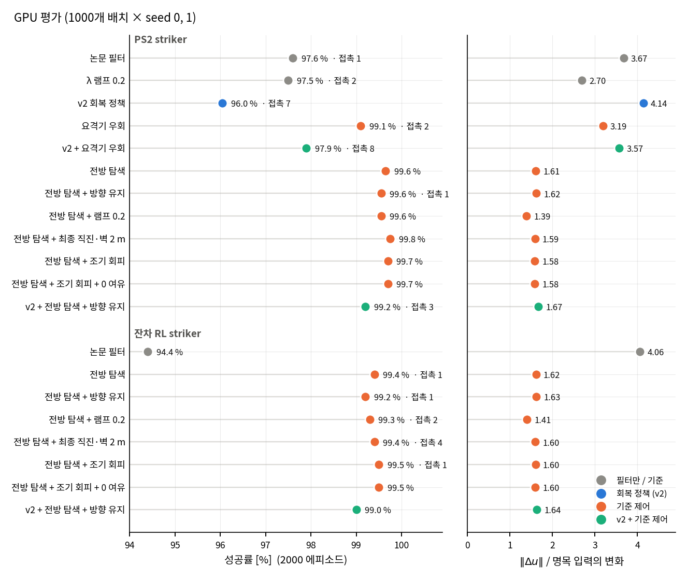

# Filter, backup and nominal changes — GPU rounds on the full test set (2026-11-01)

Run: `docker_batch/run_strike_improve.sh`, report run `outputs/strike_final`, 1000 test scenes (seed 9001) × striker /
backup seeds 0 and 1, 15 s. v2 backup: `outputs/strike_phase1_full/td3_a0p2_seed0`.

Files:
- `summary.md`: the driver's table, means over the seeds;
- `compare.md`: paired comparison (`scripts/compare_strike_improve.py`). Each variant is compared with its striker's
  reference on the same seed and scene: exact McNemar p on strike / no strike, Wilcoxon p on strike time;
- `contacts.md`: every contact;
- `s0/`, `s1/`: the evaluation tables and per-episode records;
- `gpu_results.png`: strike % and command change per setting.

Three rounds:
- round 1: the first 12 variants;
- round 2: `*_search_ramp20` and `*_searchfw`;
- round 3: `*_search_early(_zs)`, see `../lost_certificate/README.md`.

The round-1 tables do not record the heading-search options; round 2 records them (`pursuit` in the table JSON).
Variants as in the driver's default list:
- `ps2_search`: `--pursuit_detour 3 --pursuit_search 1`;
- `*h`: plus `--pursuit_search_heading_weight 0.5`;
- `*fw`: plus `--pursuit_search_final 3 --pursuit_search_wall_margin 2`;
- `*_ramp20`: plus `lam_rise_max` 0.2;
- `*_early`: plus two early-escape variants `[3.5, ±60, 6]`; `*_zs`: plus `fallback_zero_slack`.

## Results

| variant | episodes | strike % | contact | time-up % | won / lost vs ref (p) | strike time, both strike [s] | lost-cert episodes % | filter active | ‖Δu‖ / nominal |
|---|---|---|---|---|---|---|---|---|---|
| ps2_ref | 2000 | 97.60 | 1 | 2.35 | — | 6.11 | 1.45 | 0.187 | 3.68 |
| ps2_detour | 2000 | 99.10 | 2 | 0.80 | 37 / 7 (p < 0.001) | 6.00 (Δ -0.08, p < 0.001) | 2.25 | 0.161 | 3.19 |
| ps2_ramp20 | 2000 | 97.50 | 2 | 2.40 | 12 / 14 (p 0.845) | 6.10 (Δ +0.03, p < 0.001) | 1.45 | 0.185 | 2.70 |
| ps2_search | 2000 | 99.65 | 0 | 0.35 | 46 / 5 (p < 0.001) | 5.62 (Δ -0.47, p < 0.001) | 0.95 | 0.064 | 1.61 |
| ps2_search_early | 2000 | 99.70 | 0 | 0.30 | 47 / 5 (p < 0.001) | 5.56 (Δ -0.53, p < 0.001) | 0.55 | 0.056 | 1.58 |
| ps2_search_early_zs | 2000 | 99.70 | 0 | 0.30 | 47 / 5 (p < 0.001) | 5.56 (Δ -0.53, p < 0.001) | 0.50 | 0.056 | 1.58 |
| ps2_search_ramp20 | 2000 | 99.55 | 0 | 0.45 | 45 / 6 (p < 0.001) | 5.63 (Δ -0.46, p < 0.001) | 0.95 | 0.065 | 1.39 |
| ps2_searchfw | 2000 | 99.75 | 0 | 0.25 | 46 / 3 (p < 0.001) | 5.75 (Δ -0.36, p < 0.001) | 0.70 | 0.066 | 1.59 |
| ps2_searchh | 2000 | 99.55 | 1 | 0.40 | 46 / 7 (p < 0.001) | 5.62 (Δ -0.48, p < 0.001) | 0.90 | 0.064 | 1.62 |
| ps2_v2 | 2000 | 96.05 | 7 | 3.60 | 23 / 54 (p < 0.001) | 6.05 (Δ +0.04, p 0.688) | 3.35 | 0.210 | 4.14 |
| ps2_v2detour | 2000 | 97.90 | 8 | 1.70 | 39 / 33 (p 0.556) | 6.07 (Δ +0.01, p 0.002) | 4.05 | 0.184 | 3.57 |
| ps2_v2searchh | 2000 | 99.20 | 3 | 0.65 | 45 / 13 (p < 0.001) | 5.70 (Δ -0.39, p < 0.001) | 2.05 | 0.067 | 1.67 |
| residual_ref | 2000 | 94.40 | 0 | 5.60 | — | 6.53 | 1.85 | 0.223 | 4.05 |
| residual_search | 2000 | 99.40 | 1 | 0.55 | 108 / 8 (p < 0.001) | 6.00 (Δ -0.53, p < 0.001) | 1.45 | 0.073 | 1.62 |
| residual_search_early | 2000 | 99.50 | 1 | 0.45 | 108 / 6 (p < 0.001) | 5.94 (Δ -0.59, p < 0.001) | 0.80 | 0.065 | 1.60 |
| residual_search_early_zs | 2000 | 99.50 | 0 | 0.50 | 108 / 6 (p < 0.001) | 5.95 (Δ -0.58, p < 0.001) | 0.65 | 0.065 | 1.60 |
| residual_search_ramp20 | 2000 | 99.30 | 2 | 0.60 | 109 / 11 (p < 0.001) | 6.01 (Δ -0.51, p < 0.001) | 1.25 | 0.073 | 1.41 |
| residual_searchfw | 2000 | 99.40 | 4 | 0.40 | 108 / 8 (p < 0.001) | 6.10 (Δ -0.42, p < 0.001) | 1.45 | 0.073 | 1.60 |
| residual_searchh | 2000 | 99.20 | 1 | 0.75 | 107 / 11 (p < 0.001) | 5.97 (Δ -0.54, p < 0.001) | 1.35 | 0.073 | 1.63 |
| residual_v2searchh | 2000 | 99.00 | 0 | 1.00 | 104 / 12 (p < 0.001) | 6.04 (Δ -0.47, p < 0.001) | 2.05 | 0.071 | 1.64 |

## Findings

- **The heading search is the improvement.** The filter and the strikers are unchanged; the nominal's pursuit base goes
  around obstacles, walls and chasers.
  - PS2: 97.6 → 99.65 % strikes, 1 → 0 contacts, time-ups 2.35 → 0.35 %; 46 scenes won / 5 lost (p < 0.001).
  - Strikes 0.47 s sooner. Filter active 18.7 → 6.4 % of steps. ‖Δu‖ 3.68 → 1.61 times the nominal.
  - Lost-certificate episodes 1.45 → 0.95 %.
  - Residual striker: 94.4 → 99.4 % (108 won / 8 lost), 1 contact.
  - The 48-scene CPU screening predicted it: on those 48 scenes the GPU search run strikes 47 (CPU 48).
- **The heading weight is not needed** with the report's backup: 99.55 vs 99.65 %, 1 vs 0 contacts. It only helped the v2
  backup on the 48 scenes.
- **The v2 backup is rejected for the reduced arena.**
  - 96.05 %, 7 contacts; 23 won / 54 lost against the report's filter (p < 0.001).
  - Its contacts follow about 3.3 s without a certificate (161–174 steps): long stretches the v2 policy cannot certify.
  - The 48-scene screening missed this: those scenes were chosen from the reference's failures, and v2's failures lie
    elsewhere (scenes 137, 142, 474, 524, 717, 882). On the 48 the GPU v2 run strikes 40 with no contact, as on the CPU.
  - Lesson: screen a new backup on its own failures too, or on a larger random sample.
- **Chaser-only detour**: 99.1 %, 2 contacts. The heading search supersedes it.
- **λ ramp 0.2**: outcomes unchanged (12 won / 14 lost, p 0.85), ‖Δu‖ 3.68 → 2.70. A free smoothing add-on, not combined
  with the search yet.
- **Every contact, in every variant, follows a lost certificate** (31–178 steps without one). While certified, the
  filter kept every episode contact-free. The remaining gap is the backup's coverage, not the selection.

## What the remaining failures are (CPU replays of the failing scenes)

PS2 + heading search, 7 time-ups in 2000, plus the contacts of the `h` and residual variants. In the CPU replays:
- **near-target circling** (scene 382, both seeds): the target moves next to a box and the wall, so no ray to it is
  free and the drone circles 2–3 m from it for 4 s;
- **pocket deadlock** (seed 1, scene 675): the search led the drone along the top wall, 1.5 m from it, into the gap above a
  box. There only λ = 0 is certified (the report's backup does not know the walls), so it hovers for 5 s, 8 m from the
  target;
- **wandering** between two cylinders and a chaser (seed 1, scene 569; residual seed 0, scene 243);
- **contact after a lost certificate** in a narrow gap between two obstacles with a chaser behind (seed 0, scene 614 on
  the CPU; a time-up on the GPU). CPU and GPU diverge in these marginal scenes; the outcome flips between contact,
  time-up and late strike.

Two search options target the first two (both off by default):
- `--pursuit_search_final 3`: fly straight within 3 m of the target;
- `--pursuit_search_wall_margin 2`: keep the ray 2 m from the walls.

CPU check of the two options together (`final 3`, `wall_margin 2`), seed-0 and seed-1 models:
- on the replayed failing scenes, 6 of the 7 CPU failures turn into strikes (382 on both seeds, 569, 675, 614, residual
  510). Residual 243 and seed-1 692 (a GPU time-up) still time out, and PS2 seed 0, scene 510 becomes a new time-up;
- on the 48-scene set, PS2 47 / 0 / 1 (plain search 48 / 0 / 0; new time-up in 270), residual 46 / 0 / 2 (48 / 0 / 0).

## Round 2: search + ramp, search + final approach / wall margin

Paired against the plain heading search (same seed and scene):

| comparison | won / lost (McNemar p) | strike time Δ | contacts |
|---|---|---|---|
| PS2: search + final 3 m + wall 2 m vs search | 6 / 4 (0.75) | +0.12 s | 0 vs 0 |
| PS2: search + ramp 0.2 vs search | 2 / 4 (0.69) | +0.02 s | 0 vs 0 |
| residual: search + final + wall vs search | 6 / 6 (1.00) | +0.12 s | 4 vs 1 |
| residual: search + ramp 0.2 vs search | 2 / 4 (0.69) | +0.02 s | 2 vs 1 |
| PS2 search vs residual search | 10 / 5 (0.30) | −0.46 s | 0 vs 1 |

- **Final approach + wall margin: rejected.**
  - For PS2 it turns exactly the scenes the CPU replays predicted (242, 382 on both seeds, 510, 569, 675) into strikes.
  - But it loses 270 (also predicted), 376, 845 and 692, and strikes 0.12 s later.
  - For the residual striker it adds 3 contacts, all after lost certificates (44–51 steps).
  - Net, not significant.
- **λ ramp 0.2 on the search: optional.** Outcomes are not significantly different (2 / 4); ‖Δu‖ 1.61 → 1.39 and switches
  0.67 → 0.54 per second. The search has already removed most of the chattering, so the ramp adds little.
- **PS2 vs residual, both with the search.**
  - PS2: 0 contacts in every search variant (search, ramp, final/wall), lost-certificate episodes 0.70–0.95 %, strikes 0.46 s sooner.
  - Residual striker: 1–4 contacts and 1.25–1.45 % lost-certificate episodes.
  - Training through the filter keeps the striker in states the backup can certify.

## Round 3: early escapes (lost certificates)

`../lost_certificate/README.md` has the analysis.

- PS2 + search + early escapes: 99.70 %, 0 contacts, 0.30 % time-ups.
  - Steps without a certificate 665 → 112; long losses (≥ 30 steps) 7 → 0.
  - 2 won / 1 lost against the plain search; 47 / 5 against the report filter.
- Residual + search + early escapes: 99.50 %, 1 contact; lost steps 1116 → 415.
  - With the zero-slack fallback: 0 contacts, 262 lost steps.

**Recommended setting: PS2 + heading search + early escapes** (`ps2_search_early`; zero-slack fallback and λ ramp 0.2
optional):
- 99.70 % strikes, no contact, 0.30 % time-ups;
- report filter: 97.6 %, 1 contact, 2.35 %.

Next steps:
- retrain PS2 through the filter on the search base;
- the residual striker's remaining long losses: narrow gaps between two obstacles with a chaser behind (scene 614).
