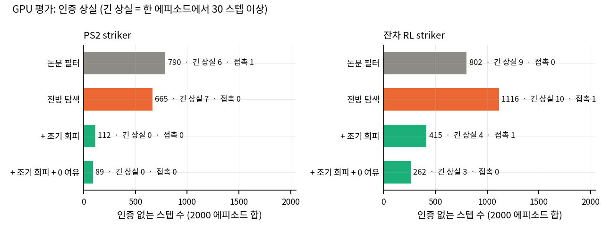

# Lost certificates — why they happen and a small fix (2026-11-01)

Setting: the recommended configuration, PS2 (or the residual striker) + heading search
(`--pursuit_detour 3 --pursuit_search 1`), the report's filter and Phase-I backup.

## What the GPU runs say (1000 scenes × 2 seeds, all variants of both rounds)

- Every contact in every variant followed a lost certificate.
- Short losses are harmless; long ones are not:

| steps without a certificate in the episode | episodes | contacts |
|---|---|---|
| 1–29 (< 0.6 s) | 186 | 0 |
| 30–59 | 28 | 6 |
| 60–119 | 29 | 1 |
| 120 or more | 25 | 8 |

- PS2 + search: 19 lost-certificate episodes in 2000, 5 of them longer than 40 steps, no contact.
- Residual + search: 29 such episodes, 10 longer than 40 steps, 1 contact.

## Why: the escape starts too late near walls and obstacles

**Method.** CPU replays of the long-loss episodes (PS2 + search: 11, residual + search: 11).
- At every 5th step without a certificate, each backup variant's own plan (blend 0) is checked with
  `scripts/diagnose_lost_certificate.py`. 280 states in all.
- The check runs from the recorded state with a fresh view and no hover latch, so it approximates the filter's own
  check (the committed state is not recorded).

**Results:**
- **No variant of the current family certifies** in these states: 1 of 280 with the fresh-plan slack, 23 of 280 on
  the safe set itself (zero slack).
- **The plans fail on h_c**: the chaser catches them (PS2: 709 of 718 variant failures; residual: 683 h_c, 517 wall).
- **The drone is next to something**: an obstacle closer than 1 m in 55 % of the states, a wall closer than 1.5 m in 56 %.
  Two chasers within 6 m: never.

**Mechanism** (figure `lc_320.png`, seed 1, scene 320, PS2 + search):
- The escape reflex of every variant blends in only below $h_c$ = 2 m (`trigger_off`), and fully below 0.5 m.
  Until then each plan follows the learned backup (or the hover LQR), which hovers or drifts.
- In 3 s a chaser 7 m away closes in. When the reflex finally starts, the drone is 1 m from the wall. The escape
  directions (away, ±60°) point into the wall or are cut off, and $h_c$ goes negative at about 2.4 s into the plan.
- With no new plan certified, the committed plan lasts only until the chaser's real position breaks it. Then the
  certificate is lost and stays lost while the drone is pinned.

In open space this never matters: the drone is faster than the chaser. It is the late start next to a wall or an obstacle.

## The fix: two early-escape variants

The same escape reflex, but starting earlier: `escape_variants` entries may now carry a third number, their own
`trigger_off`:
```json
"escape_variants": [[2.0, 60], [2.0, -60], [3.5, 0], [3.5, 60], [3.5, -60], [3.5, 60, 6], [3.5, -60, 6]]
```
The last two flee at 3.5 v_c, ±60° from the line of sight, starting below $h_c$ = 6 m (full below 4.5 m).

Nothing else changes:
- the filter and its certificate (largest certified blend over the family) are the same;
- the family only gains two members, so the certified set is the union with theirs;
- the old variants still win ties.

**Offline, at the 280 lost states:**
- **certification:** a plan with the full fresh-plan slack exists in 174 states (62 %), against 1 with the current family;
- **which variants carry it:** −60° in 58 of the 63 PS2 states, +60° in 32;
- **±90° escapes with the 2 m trigger:** no gain over the current family (the trigger timing matters, not the angle).

**Closed loop, the same 22 episodes replayed** (`replays/before_after.txt`):

| | steps without certificate | episodes with a loss | contacts | time-ups |
|---|---|---|---|---|
| search (as in the GPU round) | 1372 | 19 | 1 | 0 |
| + early escapes | 189 | 7 | 0 | 1 |
| + early escapes + zero-slack fallback | 174 | 7 | 0 | 1 |

Strikes also come sooner in most of these episodes (e.g. 790: 11.0 → 6.2 s, 953: 11.4 → 6.3 s). Larger blends get
certified, so the filter corrects less.

**Zero-slack fallback** (`fallback_zero_slack`):
- When no new plan with the slack and no committed plan certifies, it accepts a new plan certified on the safe set itself
  (h_c ≥ 0, contact distance), the standard the committed plan already uses.
- It adds little on top of the early escapes (189 → 174 steps). It stays an option.

**Regression on the 48-scene set** (seed 0; the hard and random scenes of the earlier study):

| | strike / contact / time-up | strike time vs search (Wilcoxon p) | steps without certificate | episodes with a loss |
|---|---|---|---|---|
| PS2 search | 48 / 0 / 0 | — | 20 | 3 |
| PS2 search + early escapes | 48 / 0 / 0 | −0.03 s (0.66) | 20 | 3 |
| residual search | 48 / 0 / 0 | — | 151 | 4 |
| residual search + early escapes | 48 / 0 / 0 | −0.12 s (0.12) | 7 | 1 |

No harm elsewhere: same outcomes, filter activity 11.9 → 11.5 % (PS2), command change unchanged.

## Cost

Two more variants make 9 × 5 = 45 rollouts per step instead of 35. One filter step for one vehicle, jit, 2-core CPU
under load:
- report filter: 92 ms median;
- with the early escapes: 125 ms (+36 %);
- with the zero-slack fallback as well: 127 ms.

On the GPU the variants run in parallel; the evaluation time per seed should grow far less.

## GPU check (1000 scenes × seeds 0, 1; `../improvements_gpu/`)

Driver variants:
- `ps2_search_early`, `residual_search_early`;
- `ps2_search_early_zs`, `residual_search_early_zs` (with the zero-slack fallback).



| setting (2000 episodes) | strike % | contacts | time-up % | steps without certificate | episodes with a loss | long losses (≥ 30 steps) |
|---|---|---|---|---|---|---|
| PS2, report filter | 97.60 | 1 | 2.35 | 790 | 29 | 6 |
| PS2, search | 99.65 | 0 | 0.35 | 665 | 19 | 7 |
| **PS2, search + early escapes** | **99.70** | **0** | **0.30** | **112** | **11** | **0** |
| PS2, search + early escapes + zero slack | 99.70 | 0 | 0.30 | 89 | 10 | 0 |
| residual, report filter | 94.40 | 0 | 5.60 | 802 | 37 | 9 |
| residual, search | 99.40 | 1 | 0.55 | 1116 | 29 | 10 |
| residual, search + early escapes | 99.50 | 1 | 0.45 | 415 | 16 | 4 |
| residual, search + early escapes + zero slack | 99.50 | 0 | 0.50 | 262 | 13 | 3 |

Paired against the plain search, same seed and scene:
- PS2:
  - 2 won / 1 lost (p 1.00); strikes 0.06 s sooner;
  - lost steps −83 %, long losses 7 → 0;
  - against the report filter: 47 won / 5 lost (p < 0.001), 0.53 s sooner.
- Residual:
  - 3 won / 1 lost (p 0.62);
  - lost steps −63 %, long losses 10 → 4;
  - its one contact moved from scene 795 to seed 0, scene 614: a narrow gap between two obstacles with a chaser behind, 176 steps without a certificate (the CPU replay of the same scene became a time-up).
- Zero-slack fallback:
  - PS2: identical outcomes, lost steps 112 → 89.
  - Residual: lost steps 415 → 262, long losses 4 → 3, its last contact gone (1 → 0, too few to call).

**Verdict: adopt the early escapes.**
- The long losses, the ones that end in contacts, vanish for PS2 and drop by 60 % for the residual striker.
- Outcomes do not suffer.
- GPU evaluation time grows 26 % (349 → about 440 s per 1000 episodes).

The zero-slack fallback is cheap (+2 % compute) and keeps the certificate's meaning; optional, worth keeping for the
residual striker.

Remaining: scene 614-type gaps for the residual striker (long losses 3–4 in 2000).
